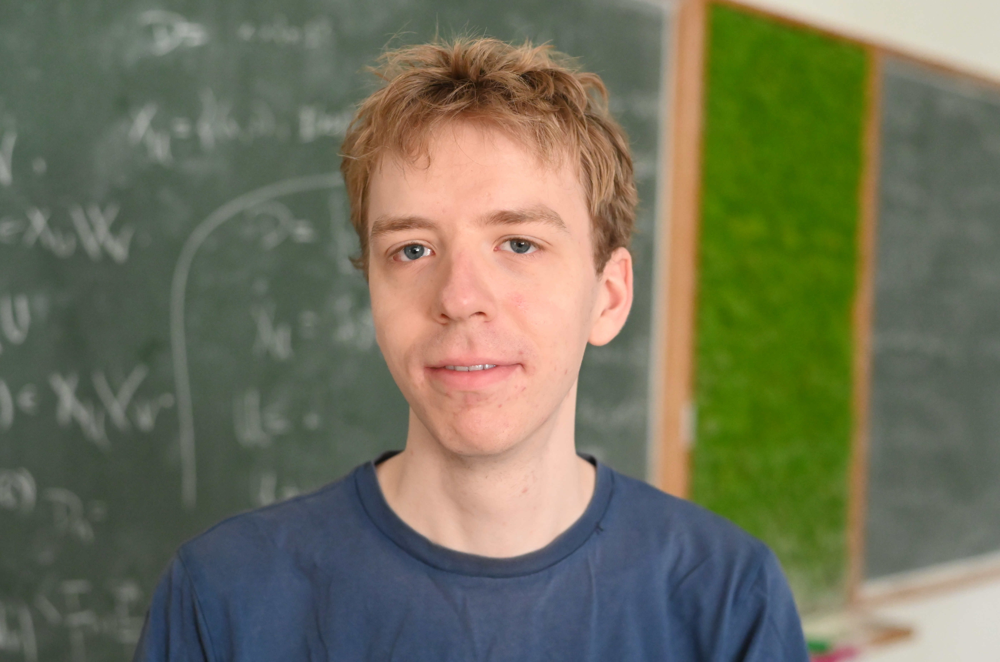

 <!DOCTYPE html>
<html lang="en">
<head>
</head>
<body>
  <h1>Sven Manthe</h1>
  

    

      
I am a postdoc with <a href="https://ivv5hpp.uni-muenster.de/u/rds">Ralf Schindler</a> at Münster. 
	My current research topic are monadic second-order order theories of uncountable structures.

      
E-mail: <a href="mailto:sven.manthe@uni-muenster.de">sven.manthe@uni-muenster.de</a> 
	Office: SRZ 322

    

    
  

  <h3>Publications and Preprints</h3>
  <ul>
    <li>"The Borel monadic theory of order is decidable", <a href="https://arxiv.org/abs/2410.00887">arXiv</a></li>
    <li>"Automata for MSO over Infinite Trees with Quantification over Borel Sets of Branches", <a href="https://doi.org/10.4230/LIPIcs.LICS.2026.21">Logic in Computer Science 2026</a></li>
    <li>"A Cobham theorem for scalar multiplication", with Philipp Hieronymi and Chris Schulz, <a href="https://arxiv.org/abs/2407.15118">arXiv</a></li>
    <li>"A formalization of Borel determinacy in Lean", <a href="https://arxiv.org/abs/2502.03432">arXiv</a>, <a href="https://doi.org/10.46298/afm.15202">Annals of Formalized Mathematics, Volume 2 (2026), pp. 38-54</a></li>
    <li>Appendix of "Generation of local unitary groups", with Simon Brandhorst and Tommy Hofmann, <a href="https://arxiv.org/abs/2104.12529">arXiv</a>, <a href="https://doi.org/10.1016/j.jalgebra.2022.07.007">Journal of Algebra, Volume 609 (2022), pp. 484-513</a></li>
    <li>"Decidability in Borel Monadic Logic", PhD thesis, <a href="phd_thesis.pdf">PDF</a></li>
  </ul>
  <a href="cv.pdf">Curriculum Vitae</a>
</body>
</html>
